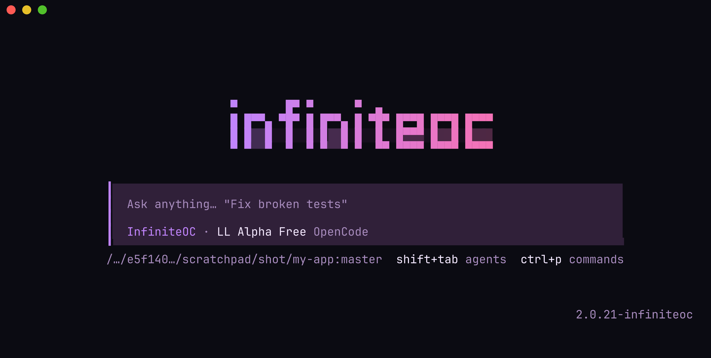
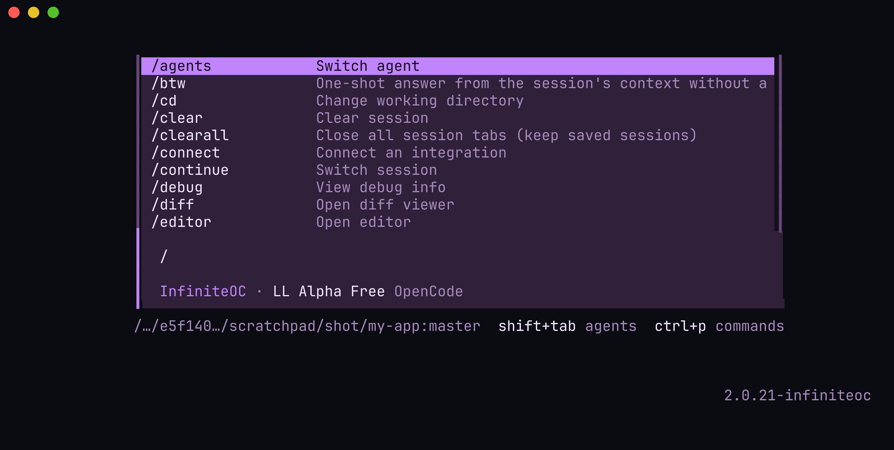
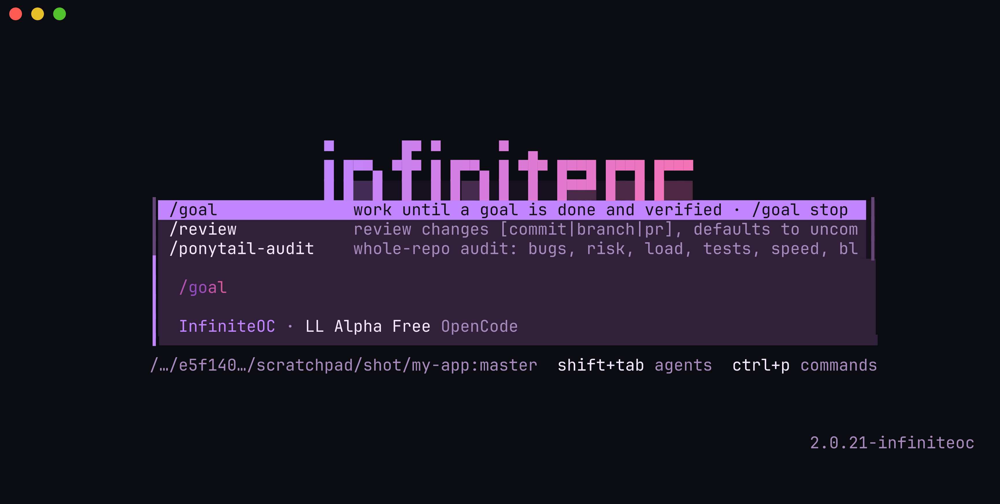

<p align="center">
  
</p>

<p align="center">
  <b>OpenCode with superpowers.</b><br>
  Keeps working until the job is done, runs subagent workflows in parallel, connects to ~90 apps, and is easy to extend.
</p>

<p align="center">
  <a href="LICENSE"></a>
  
  
</p>

<p align="center">
  
</p>

InfiniteOC is a modded build of [OpenCode](https://github.com/sst/opencode). It keeps working until a job is done
(`/goal`), runs subagent workflows in parallel, connects to ~90 apps (`/apps`), and is easy to extend with your
own mods. It installs next to stock OpenCode and never changes it.

## See it

<table>
  <tr>
    <td width="50%"><br><sub>Type <code>/</code> for every command.</sub></td>
    <td width="50%"><br><sub><code>/goal</code> works until the goal is built and verified.</sub></td>
  </tr>
</table>

## Install

You need [Node.js 22+](https://nodejs.org) and [Git](https://git-scm.com). No administrator rights.

**macOS / Linux**

```sh
curl -fsSL https://raw.githubusercontent.com/riz3y0/InfiniteOC/main/install.sh | sh
```

**Windows** (PowerShell)

```powershell
irm https://raw.githubusercontent.com/riz3y0/InfiniteOC/main/install.ps1 | iex
```

That's it. Open a new terminal, go to a project and run:

```sh
infiniteoc
```

The first run asks a few setup questions (provider, model, theme); Enter skips any of them. With no provider you
get OpenCode's free model; add Claude, GPT, Gemini or others later with `/connect`. Where a prebuilt binary
exists for your system it starts right away; otherwise the first run builds it (a few minutes). If
`infiniteoc` is not found, the installer printed the folder to add to your PATH.

## Everyday use

| Type this in InfiniteOC | What it does |
| --- | --- |
| `/goal <what done means>` | Works on its own until the goal is built, tested and verified. `/goal stop` ends it. |
| "make me a …" | Something new gets its own project in `~/infiniteoc-projects` (the agent creates it, `git init`s it and moves there); "open my … project" switches. |
| `/apps` | Connect GitHub, Google, Cloudflare, Discord, Telegram, iMessage, Figma, Linear, Notion and more. |
| `/connect` | Sign in to an AI provider (Claude, GPT, Gemini, ...). |
| `/settings` | Custom providers, proxy/Tor, updates, workflows. |
| `/workflows` | See and cancel background subagent workflows. |
| `/account` | Switch between several logins per provider. |
| `/ponytail auto` | Minimal-code mode: smallest change that solves it. |
| `/yolo` | Auto-approve permission prompts for this session (asks first). |

From a shell:

| Command | What it does |
| --- | --- |
| `infiniteoc [folder]` | Start InfiniteOC (resume with `infiniteoc -s SESSION_ID`). |
| `infiniteoc new NAME` | Create a project in `~/infiniteoc-projects` and open it (`--template node\|python\|web`); `infiniteoc projects` lists them. |
| `infiniteoc connect` | List or add app connectors (same as `/apps`). |
| `infiniteoc graph` | A local, Obsidian-style graph of your projects, sessions and notes. |
| `infiniteoc web` | The browser UI, with a one-time sign-in link. |
| `infiniteoc doctor` | Check that everything is set up; `--fix` repairs it. |
| `infiniteoc update` | Update now (it also checks by itself every 6 hours). |

## Make your own mod

```sh
infiniteoc feature new my-mod      # creates ~/.config/infiniteoc/mods/my-mod
infiniteoc feature enable my-mod   # checks it, then turns it on
```

Your mods live in `~/.config/infiniteoc/mods`, a folder of your own (a local git repository with no remote),
not in the InfiniteOC install. So updates never fight your changes, and an AI that writes a mod for you commits
it there instead of trying to push to InfiniteOC; installs refuse to push. Mods are trusted code: only enable
ones you have read. How to write one: [FEATURES.md](FEATURES.md).

## Update and uninstall

InfiniteOC updates itself at launch (choose auto, ask or off in `/settings`). To remove it:
`sh ~/.infiniteoc/uninstall.sh` (macOS/Linux) or `& "$env:LOCALAPPDATA\InfiniteOC\uninstall.ps1"` (Windows).
Your stock OpenCode, its sessions and settings are never touched.

## More

- [GUIDE.md](GUIDE.md): everything that is built in, connectors, graph, builds, configuration.
- [LAUNCHER.md](LAUNCHER.md): install options, prebuilt binaries, serve/web, remote control, mod packs, bench.
- [FEATURES.md](FEATURES.md) and [AGENTS.md](AGENTS.md): writing mods (for you and for AI agents).
- Working on InfiniteOC itself: clone this repository, `node bin/infiniteoc.mjs setup`, `npm test`.

Independent community project, not affiliated with the OpenCode authors. No OpenCode source is vendored here:
setup clones the pinned upstream tag (MIT) and builds from a copy. License: [MIT](LICENSE) ·
[NOTICE.md](NOTICE.md) · [SECURITY.md](SECURITY.md).
