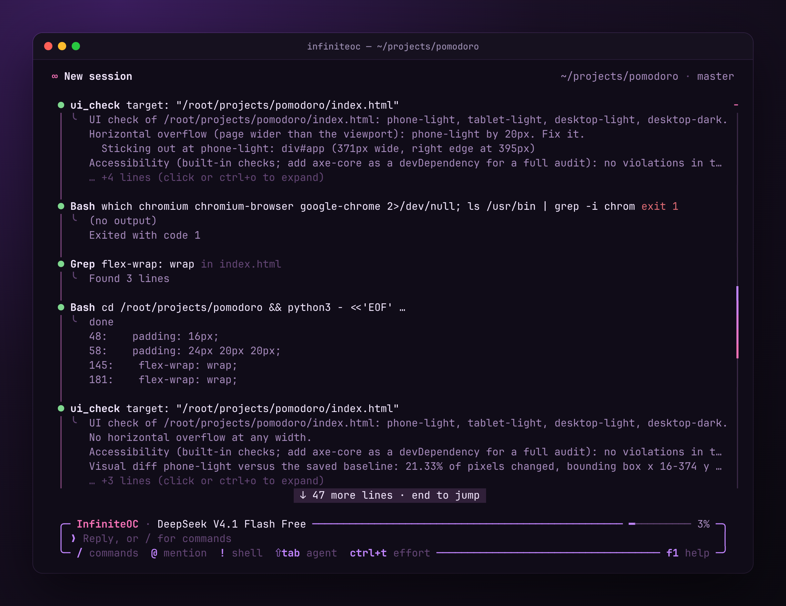
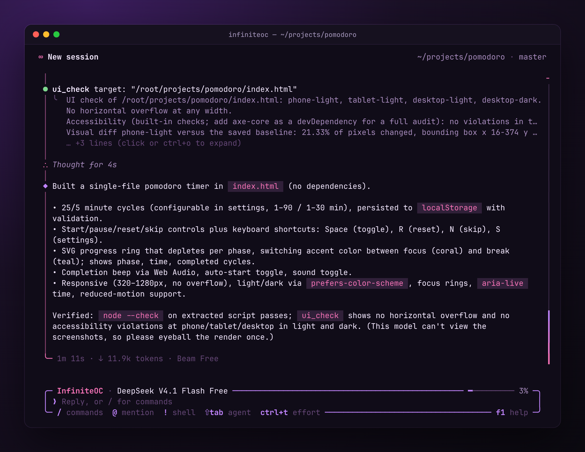
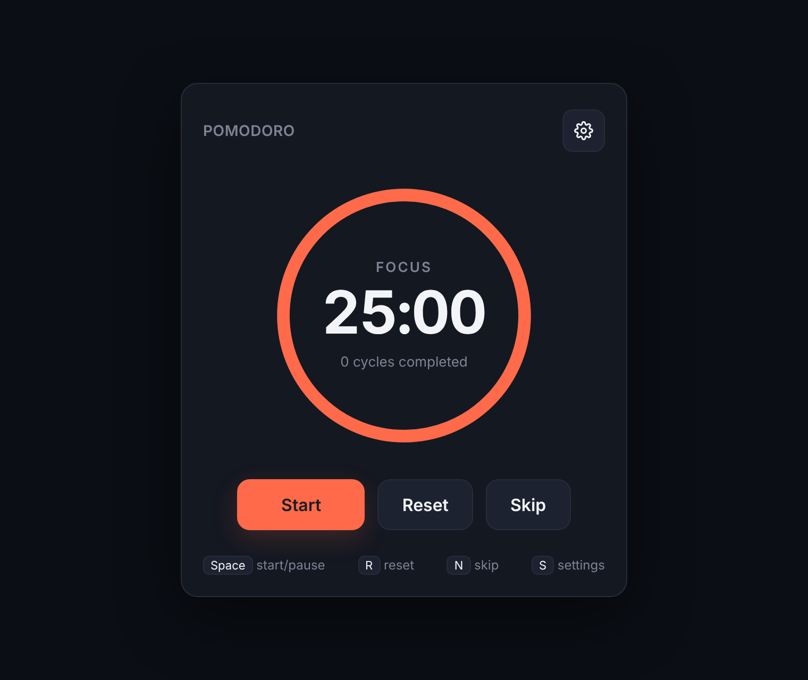
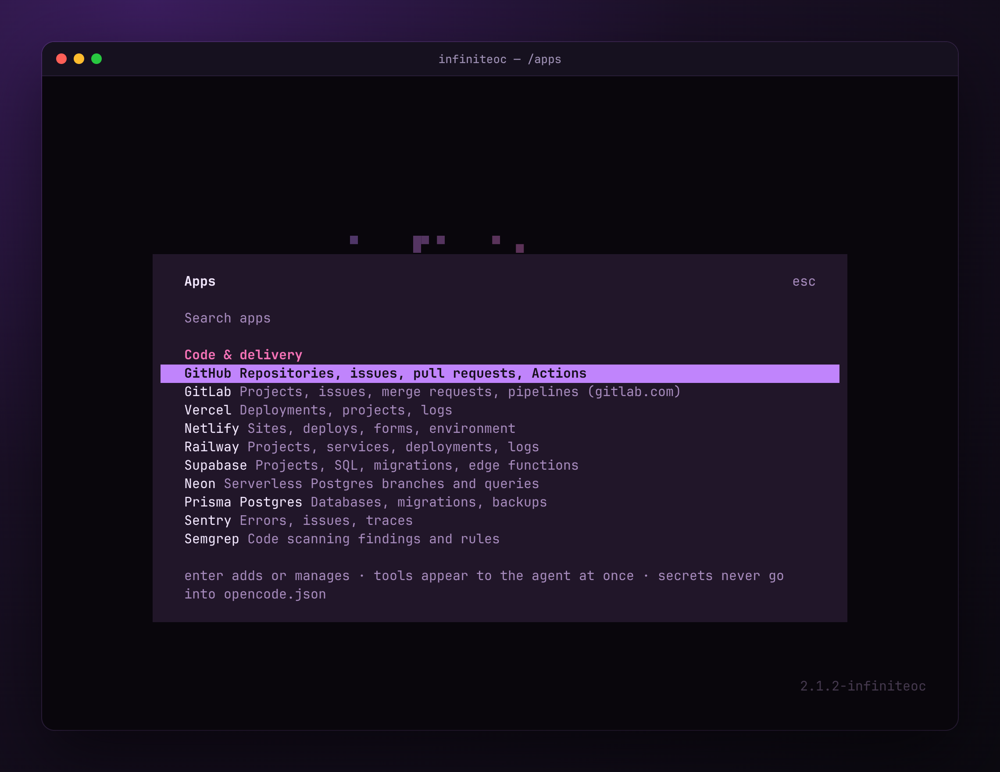

<p align="center">
  
</p>

<p align="center">
  <b>OpenCode that finishes the job.</b><br>
  Its own fast terminal UI, a <code>/goal</code> mode that keeps going until the work is verified, checks that catch
  UI bugs before you do, free models with automatic fallback, and ~90 app connectors.
</p>

<p align="center">
  <a href="LICENSE"></a>
  
  
  
</p>

<p align="center">
  
</p>

InfiniteOC is a modded build of [OpenCode](https://github.com/sst/opencode). It keeps working until a job is done
(`/goal`), checks its own work, runs subagent workflows in parallel, connects to ~90 apps (`/apps`), and is easy to
extend with your own mods. It installs next to stock OpenCode and never changes it.

## Install

**macOS / Linux**

```sh
curl -fsSL https://raw.githubusercontent.com/InfiniteOC/InfiniteOC/main/install.sh | sh
```

**Windows** (PowerShell)

```powershell
irm https://raw.githubusercontent.com/InfiniteOC/InfiniteOC/main/install.ps1 | iex
```

You need [Node.js 22+](https://nodejs.org) and [Git](https://git-scm.com); no administrator rights. Read a script
before you pipe it to a shell, or clone first and run the copy you read:
`git clone https://github.com/InfiniteOC/InfiniteOC.git ~/.infiniteoc && sh ~/.infiniteoc/install.sh`.

Then open a new terminal, go to a project and run:

```sh
infiniteoc
```

The first run asks a few setup questions (provider, model, theme); Enter skips any of them. With no provider you
get OpenCode's free models; add Claude, GPT, Gemini or others any time with `/connect`. Where a prebuilt binary
exists for your system it starts right away; otherwise the first run builds it (a few minutes). If `infiniteoc` is
not found, the installer printed the folder to add to your PATH.

## See it

One prompt, a free model, 71 seconds: _"Build a pomodoro timer in index.html: 25/5 minute cycles, start/pause/reset,
a progress ring and keyboard shortcuts."_

<table>
  <tr>
    <td width="50%"><br><sub><code>ui_check</code> renders the page on phone, tablet and desktop, in light and dark. Here it found the layout 20&nbsp;px too wide on phones and named the element; the agent fixed it and checked again.</sub></td>
    <td width="50%"><br><sub>The run ends with what was built and how it was verified. The model was rate limited halfway, so the run continued on the fallback model.</sub></td>
  </tr>
  <tr>
    <td width="50%"><br><sub>What it built: one file, no dependencies, keyboard shortcuts, light and dark.</sub></td>
    <td width="50%"><br><sub><code>/apps</code> connects GitHub, Google, Notion, Linear, Vercel, Supabase and ~85 more; their tools appear to the agent at once.</sub></td>
  </tr>
</table>

## What you get

- **InfiniTUI**, a fast terminal interface written in Go (the default). `/classic` switches to OpenCode's own
  interface on the same session; see [mods/infinitui](mods/infinitui/README.md).
- **`/goal`** keeps working, step after step, until the goal is built, tested and verified.
- **It checks its own work.** `ui_check` renders web pages at several sizes and in both color schemes and reports
  overflow (naming the element that sticks out), accessibility problems, missing files and visual changes. A file
  that no longer parses is reported on the edit that broke it.
- **Free to start.** OpenCode's free models work with no account; when a model is rate limited or down, the run
  continues on your fallback model (`/routing fallback`).
- **Sturdier tool calls.** File text a model leaked into a path is repaired instead of creating junk folders, several
  tool calls packed into one are refused instead of written to disk, and stray heredoc markers are dropped.
- **Lean.** A slimmer system prompt and tool list, a model catalog built only for the providers you use, and cached
  schemas: with its ~40 mods it still starts and steps a little faster than stock OpenCode.
- **Your own mods.** Change anything with a mod in your own folder; updates never touch it.

## Everyday use

| Type this in InfiniteOC | What it does |
| --- | --- |
| `/goal <what done means>` | Works on its own until the goal is built, tested and verified. `/goal stop` ends it. |
| "make me a …" | Something new gets its own project in `~/infiniteoc-projects` (the agent creates it, `git init`s it and moves there); "open my … project" switches. |
| `/connect` | Sign in to an AI provider (Claude, GPT, Gemini, ...). |
| `/apps` | Connect GitHub, Google, Cloudflare, Discord, Telegram, iMessage, Figma, Linear, Notion and more. |
| `/models` · `ctrl+t` | Pick a model · cycle its effort. `/infinicode` is the all-in effort level. |
| `/settings` | Custom providers, proxy/Tor, updates, workflows. |
| `/workflows` | See and cancel background subagent workflows. |
| `/account` | Switch between several logins per provider. |
| `/routing fallback opencode/beam-free` | When your model is rate limited or down (a free tier's limit included), the run continues on this one. |
| `/ponytail auto` | Minimal-code mode: smallest change that solves it. |
| `/yolo` | Auto-approve permission prompts for this session (asks first). |
| `/classic` | Switch to the classic OpenCode interface on the same session. `"tui": "classic"` in settings makes it permanent. `/connect`, `/apps`, `/settings` and `/account` open their dialog there and come back by themselves. |

From a shell:

| Command | What it does |
| --- | --- |
| `infiniteoc [folder]` | Start InfiniteOC (resume with `infiniteoc -s SESSION_ID`). |
| `infiniteoc run "…"` | One prompt without the interface; prints the answer (`--format json` for events). |
| `infiniteoc new NAME` | Create a project in `~/infiniteoc-projects` and open it (`--template node\|python\|web`); `infiniteoc projects` lists them. |
| `infiniteoc connect` | List or add app connectors (same as `/apps`). |
| `infiniteoc graph` | A local, Obsidian-style graph of your projects, sessions and notes. |
| `infiniteoc web` | The browser UI, with a one-time sign-in link. |
| `infiniteoc doctor` | Check that everything is set up; `--fix` repairs it. |
| `infiniteoc update` | Update now (it also checks by itself every 6 hours). |

## Make your own mod

```sh
infiniteoc feature new my-mod      # creates ~/.config/infiniteoc/mods/my-mod
infiniteoc feature enable my-mod   # checks it, then turns it on
```

Your mods live in `~/.config/infiniteoc/mods`, a folder of your own (a local git repository with no remote),
not in the InfiniteOC install. So updates never fight your changes, and an AI that writes a mod for you commits
it there instead of trying to push to InfiniteOC; installs refuse to push. Mods are trusted code: only enable
ones you have read. How to write one: [FEATURES.md](FEATURES.md).

## Update and uninstall

InfiniteOC updates itself at launch (choose auto, ask or off in `/settings`); an update that does not build rolls
back to the version you had. To remove it: `sh ~/.infiniteoc/uninstall.sh` (macOS/Linux) or
`& "$env:LOCALAPPDATA\InfiniteOC\uninstall.ps1"` (Windows). Your stock OpenCode, its sessions and settings are never
touched.

## More

- [GUIDE.md](GUIDE.md): everything that is built in, connectors, graph, builds, configuration.
- [LAUNCHER.md](LAUNCHER.md): install options, prebuilt binaries, serve/web, remote control, mod packs, bench.
- [FEATURES.md](FEATURES.md) and [AGENTS.md](AGENTS.md): writing mods (for you and for AI agents).
- Working on InfiniteOC itself: clone this repository, `node bin/infiniteoc.mjs setup`, `npm test`. To check that a
  change makes real runs better, compare two checkouts with [scripts/eval](scripts/eval/README.md).

Independent community project, not affiliated with the OpenCode authors. No OpenCode source is vendored here:
setup clones the pinned upstream tag (MIT) and builds from a copy. License: [MIT](LICENSE) ·
[NOTICE.md](NOTICE.md) · [SECURITY.md](SECURITY.md).
